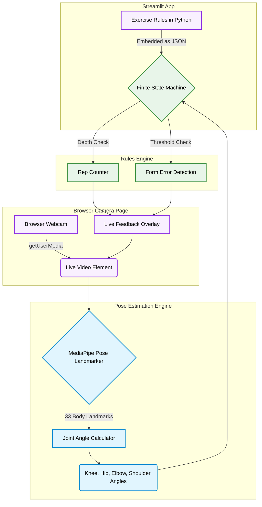

<div align="center">

# AI-Based Physiotherapy Posture Checker

**Real-time exercise form feedback using in-browser pose estimation - counts reps, flags shallow reps, and calls out common form errors as they happen**

[](https://www.python.org/)
[](https://streamlit.io/)
[](https://developers.google.com/mediapipe)
[](https://developer.mozilla.org/docs/Web/JavaScript)

</div>

---

## Overview

An AI physiotherapy app that gives real-time feedback on exercise form. It uses MediaPipe to track body landmarks in the browser, turns those
landmarks into joint angles (knee, hip, elbow, shoulder), and runs each
angle stream through a small per-exercise rule set: a 2-state machine for
rep counting (squat, push-up), plus threshold-based form checks (leaning too far forward,
elbow swinging away from the torso, hips sagging).

No exercise-classification model, no dataset to collect or label - the
"AI" here is pose estimation; everything downstream of the landmarks is
interpretable geometry, which also means every piece of feedback is
explainable (you can point at the exact angle and threshold that fired).

The camera feed is shown directly by the browser at up to 720p and is never
uploaded, so the video stays sharp and there is no server round trip.

---

### Computer Vision Pipeline



## Features

|                                      |                                                                                                                                                        |
| ------------------------------------ | ------------------------------------------------------------------------------------------------------------------------------------------------------ |
| **Rep Counting**                     | 2-state machine per exercise, driven by one primary joint angle (e.g. knee angle for squats)                                                           |
| **Shallow-Rep Detection**            | Tracks the minimum angle reached during the "down" phase - flags reps that didn't reach full depth                                                     |
| **Live Form Feedback**               | Threshold-based checks per exercise (forward lean, elbow swing, sagging hips), shown as an on-screen overlay and in the stats panel                    |
| **Sharp, Direct Video**              | The browser shows the camera directly at up to 720p, with no compression or server round trip                                                         |
| **Private by Design**                | Pose detection runs on the device, so video is never uploaded                                                                                          |
| **Testable Core Logic**              | Angle math and rep/hold state machines need no webcam, so they are unit tested in isolation                                                            |

---

## Tech Stack

**Languages** - Python 3.x, JavaScript
**Pose Estimation** - MediaPipe Pose Landmarker (`@mediapipe/tasks-vision`, running in the browser)
**Video** - Browser `getUserMedia`, with the skeleton drawn on a canvas overlay
**App** - Streamlit
**Testing** - pytest, Node test runner

---

## Architecture Overview

```
exercise_rules.py  → declarative per-exercise spec (angles, thresholds, rep stages)
   │  camera_page.py embeds the specs as JSON
   ▼
Streamlit page (app.py) → st.iframe(self-contained camera page)
   │
   ▼  Everything below runs in the browser
Browser webcam (getUserMedia) → <video>, shown directly
   │
   ▼
MediaPipe Pose Landmarker in a background worker  (src/web/pose_worker.js)
   │  33 body landmarks
   ▼
FormAnalyzer.process()  (src/web/form_logic.js)
   │  angle geometry, RepCounter (squat/push-up), HoldTimer, form checks
   ▼
Skeleton on a canvas overlay + live stats + feedback list
```

**Design choices:**

- **Declarative exercise specs, not per-exercise branching code.** Adding a
  new exercise means adding one `ExerciseSpec` to `exercise_rules.py` - the
  analyzer's control flow doesn't change, and Python stays the one place
  thresholds are defined.
- **Rule-based, not a learned classifier.** Transparent, zero training
  cost, tunable by eye from a few test videos. The trade-off is manual
  threshold tuning per exercise/body type - see Limitations.
- **Analyzer has zero UI dependency.** `FormAnalyzer.process()` takes
  landmarks and returns a plain object - it doesn't know the camera or
  Streamlit exist, so the angle/rep-counting logic is unit tested directly.
- **Video stays in the browser.** Sending frames to a server and back meant
  compressing them twice, which limited quality to 640×480 at about 15 fps.
  Running detection on the device removes that trip entirely, and a
  background worker keeps it from ever stalling the video.
- **Thresholds keep their tuned meaning.** Angles are measured on normalized
  coordinates and the thresholds were tuned on 4:3 video, so wider video is
  rescaled before measuring.

---

## Setup and Installation

### 1. Clone the repository

```bash
git clone https://github.com/Shashank17singh/SIC-Project.git
cd SIC-Project
```

### 2. Create a virtual environment and install dependencies

```bash
python3 -m venv venv
source venv/bin/activate   # Windows: venv\Scripts\activate
pip install -r requirements.txt
```

### 3. Run the app

```bash
streamlit run app.py
```

Open the URL Streamlit prints, click **Start** under the video panel, allow
camera access, and pick an exercise from the panel beside it. The first start
downloads the pose model (about 9 MB), and the browser caches it after that.

### 4. Run the tests

```bash
pytest tests/ -v
node --test tests/form_logic.test.js
```

---

## Usage Tips

- Stand **side-on** to the camera (sagittal view) - the joint angles this
  app checks (knee, hip, elbow) are only meaningful from a side angle, not
  face-on.
- Make sure your full body is in frame - the app
  will tell you when a needed landmark isn't visible enough rather than
  silently guessing.
- Good, consistent lighting matters more than camera resolution for
  MediaPipe's detection confidence.

---

## Limitations

- **2D angles only.** MediaPipe Pose here runs on a single RGB frame with
  no depth sensor, so angles are computed in the image plane. A camera
  angle that isn't roughly perpendicular to the plane of motion will
  distort the numbers - this is the single biggest source of false
  feedback.
- **Thresholds are hand-tuned, not personalized.** The same "too shallow"
  or "leaning too far" cutoffs apply to everyone; a rigorous version would
  calibrate per-user from a short warm-up set or use range-of-motion
  history.
- **Not a medical device.** This flags form patterns against fixed
  geometric rules - it does not diagnose injury risk and isn't a
  substitute for in-person physiotherapist supervision.
- **Needs a capable device.** Pose detection runs on the visitor's own
  device, so an older phone or laptop will update the skeleton less often,
  though the video itself stays smooth. The page also needs internet access to
  fetch the model and MediaPipe runtime.
- **Single person, single exercise at a time.** No multi-person tracking
  or automatic exercise detection (the user selects the exercise from
  radio buttons).

---

## Future Work

- Automatic exercise recognition (classify which exercise is being
  performed instead of manual radio button selection).
- Per-user threshold calibration from a short calibration set.
- Session history and progress tracking across workouts.
- Swap the 2-state rep counter for a learned temporal segmentation model
  once there's a labeled rep dataset to justify it.

---

## License

MIT

---

## Deployment

- **Dashboard URL:** https://sic-project.streamlit.app/

---


