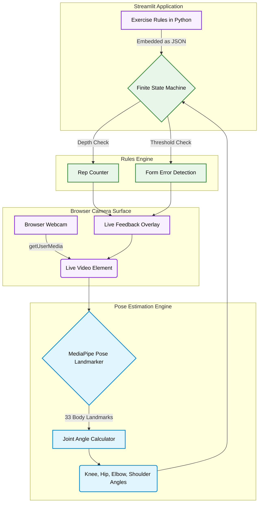

# AI-Based Physiotherapy Posture Checker

Real-time exercise form feedback using in-browser pose estimation, counts reps, flags shallow reps, and calls out common form errors as they happen.

> **Live Deployments:**
> * **Interactive Streamlit App:** [sic-project.streamlit.app](https://sic-project.streamlit.app/)

---

## Overview

AI-Based Physiotherapy Posture Checker provides instantaneous biomechanical form analysis for physical rehabilitation and strength exercises. Using client-side MediaPipe pose landmark estimation running entirely in the browser, the application converts 33 skeletal coordinates into geometric joint angles (knee, hip, elbow, and shoulder). 

Each angle stream is evaluated through a deterministic exercise rules engine: finite state machines track repetition cycles (squats and push-ups) and threshold checks detect common form deviations (forward lean, elbow flares, and hip sagging) in real time without sending camera streams to remote servers.

---

## Architecture Overview



```
exercise_rules.py  → declarative per-exercise spec (angles, thresholds, rep stages)
   │  camera_page.py embeds specs as JSON
   ▼
Streamlit page (app.py) → st.components.v1.html(self-contained camera page)
   │
   ▼  Executed entirely within the client browser
Browser webcam (getUserMedia) → <video> element
   │
   ▼
MediaPipe Pose Landmarker in Web Worker (src/web/pose_worker.js)
   │  33 skeletal landmarks
   ▼
FormAnalyzer.process() (src/web/form_logic.js)
   │  angle geometry, RepCounter state machine, HoldTimer, threshold checks
   ▼
Canvas overlay rendering skeleton + live repetition metrics + form alert panel
```

---

## Features

| Feature | Description |
| ------- | ----------- |
| **Repetition Counting** | 2-state finite state machine per exercise driven by primary joint angles (e.g. knee flexion for squats) |
| **Shallow-Rep Detection** | Tracks minimum inflection angle reached during the eccentric phase to flag incomplete range of motion |
| **Real-Time Biomechanical Alerts** | Identifies posture compensations (forward torso lean, elbow flaring, hip drop) as visual overlays |
| **Direct Hardware Video Stream** | High-definition (up to 720p) video rendered directly on client canvases with zero server round-trip latency |
| **Client-Side Privacy** | Full MediaPipe computer vision inference executes on-device; video frames are never transmitted externally |
| **Isolated Testable Geometry** | Angle calculations and finite state machines are decoupled from UI elements and verified via automated test suites |

---

## Technology Stack

| Component | Technology |
| --------- | ---------- |
| Application Framework | Streamlit, Python 3.10+ |
| Computer Vision & Pose | MediaPipe Pose Landmarker (`@mediapipe/tasks-vision`) |
| Client Video & Rendering | HTML5 `getUserMedia`, Canvas API, Web Workers |
| Web Architecture | Vanilla JavaScript ES6 |
| Testing | pytest (Python rules), Node.js test runner (JS analyzer) |
| Containerization | Docker |

---

## Project Structure

```
SIC-Project/
├── app.py                      # Streamlit application entrypoint
├── src/
│   ├── camera_page.py          # HTML/JS iframe builder and spec serializer
│   ├── exercise_rules.py       # Declarative joint angles, thresholds, and rep rules
│   ├── pose_utils.py           # Coordinate conversions and geometry helpers
│   └── web/
│       ├── form_logic.js       # Client-side angle calculator and rep counter state machine
│       └── pose_worker.js      # Background web worker running MediaPipe vision tasks
├── tests/
│   ├── test_exercise_rules.py  # Python unit tests for exercise specifications
│   └── form_logic.test.js      # JavaScript unit tests for client geometry and state machines
├── Dockerfile                  # Container definition
├── requirements.txt            # Python dependencies
└── README.md
```

---

## Setup and Installation

### Prerequisites

- Python 3.10+
- Node.js 18+ (for running JavaScript logic tests)
- A modern browser with WebGL and camera permissions enabled

### 1. Clone the repository

```bash
git clone https://github.com/Shashank17singh/SIC-Project.git
cd SIC-Project
```

### 2. Install dependencies

```bash
python -m venv venv
# Linux / macOS:
source venv/bin/activate
# Windows:
venv\Scripts\activate

pip install -r requirements.txt
```

### 3. Run the application

```bash
streamlit run app.py
```

Open the local URL displayed in the terminal, allow webcam access, and select an exercise from the sidebar.

---

## Usage Guidelines

- **Sagittal Alignment:** Position your camera side-on (sagittal plane) relative to your body; planar joint angle mathematics (knee, hip, elbow) require perpendicular perspective.
- **Full-Body Framing:** Ensure head, torso, knees, and ankles remain in the camera frame throughout the full range of motion.
- **Lighting Conditions:** Uniform, direct lighting improves MediaPipe keypoint detection confidence and minimizes jitter.

---

## Running the Tests

Execute Python exercise specification tests:

```bash
pytest tests/ -v
```

Execute JavaScript geometry and state machine tests:

```bash
node --test tests/form_logic.test.js
```

Run static code analysis:

```bash
ruff check .
```

---

## Deployment

The application is containerized and deployable to standard container hosts:

```bash
docker build -t sic-posture-checker .
docker run -p 8501:8501 sic-posture-checker
```

Live deployment is hosted on Streamlit Community Cloud at [sic-project.streamlit.app](https://sic-project.streamlit.app/).

---

## Known Limitations

- **2D Planar Projection:** Joint angles are computed in the 2D camera image plane; non-perpendicular camera angles distort planar measurements.
- **Fixed Angle Thresholds:** Thresholds represent generalized biomechanical guidelines and do not dynamically calibrate for individual anthropometric variations.
- **Non-Diagnostic:** The software provides athletic form feedback and is not a medical diagnostic tool or substitute for clinical physiotherapy supervision.

---

## License

This project is licensed under the MIT License. See [LICENSE](LICENSE) for details.
